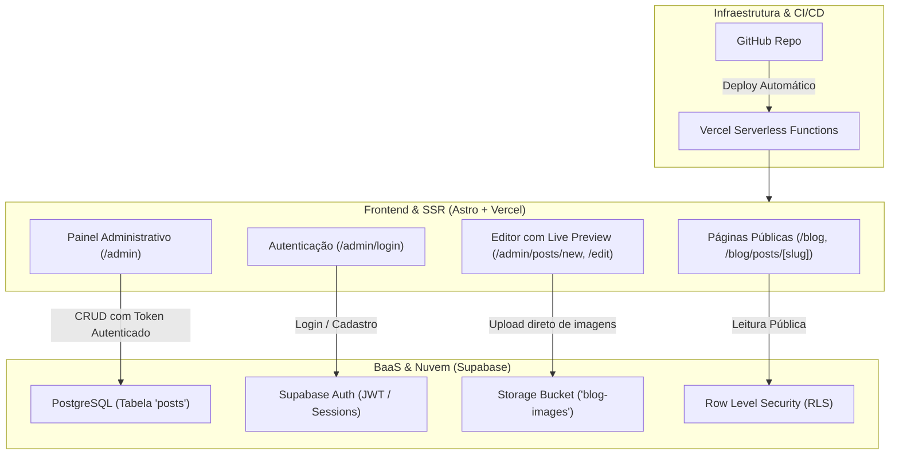

# 🚀 Relatório de Migração SaaS: Blog & Studio Admin

Este documento detalha a transformação arquitetural do portfólio e blog estático de Bernardo Nogueira em uma aplicação SaaS moderna, dinâmica e escalável de custo zero inicial, utilizando a stack **Astro SSR + Vercel + Supabase**.

---

## 📌 1. Visão Geral da Arquitetura

---

## 🗄️ 2. Supabase Configurado

- **Projeto Criado:** `bernardo-blog-saas` (ID: `nstduenjmscgglacgmqh`)
- **Região:** `sa-east-1` (São Paulo, Brasil) — Baixa latência
- **Status:** Ativo e Saudável (`ACTIVE_HEALTHY`)
- **API URL:** `https://nstduenjmscgglacgmqh.supabase.co`
- **Anon Key:** Configurada no arquivo `.env` e `.env.example`

### Estrutura da Tabela `public.posts`

| Campo | Tipo | Descrição |
| :--- | :--- | :--- |
| `id` | `UUID` (PK) | Identificador único gerado por `gen_random_uuid()` |
| `slug` | `TEXT` (UNIQUE) | Identificador legível para URL (ex: `saude-fetal`) |
| `title` | `TEXT` | Título do artigo |
| `author` | `TEXT` | Nome do autor (padrão: `Bernardo Nogueira`) |
| `pub_date` | `DATE` | Data de publicação |
| `description` | `TEXT` | Resumo para cards e meta tags de SEO |
| `content` | `TEXT` | Conteúdo completo em Markdown |
| `tags` | `TEXT[]` | Lista de categorias (ex: `Python`, `Ciência de Dados`) |
| `languages` | `TEXT[]` | Tecnologias/linguagens (ex: `python`, `scikit_learn`) |
| `project` | `BOOLEAN` | Define se aparece na seção de Projetos do portfólio |
| `image_url` | `TEXT` | URL da imagem de capa |
| `image_alt` | `TEXT` | Texto alternativo de acessibilidade |
| `status` | `TEXT` | Estado da publicação (`published`, `draft`, `archived`) |
| `created_at` | `TIMESTAMPTZ` | Timestamp de criação |
| `updated_at` | `TIMESTAMPTZ` | Timestamp da última atualização |

### Segurança e RLS (Row Level Security)

- **Leitura Pública:** Permitida irrestritamente apenas para artigos com `status = 'published'`.
- **Gestão Administrativa:** Usuários autenticados no Supabase Auth têm permissão total de `INSERT`, `UPDATE`, `DELETE` e `SELECT` em qualquer status (incluindo rascunhos).
- **Storage:** Bucket público `blog-images` configurado com políticas para upload/edição/exclusão exclusiva de usuários autenticados.

---

## 📦 3. Migração dos Posts Existentes

Os 6 artigos originais em Markdown foram extraídos, sanitizados e migrados para o banco de dados:

1. **Saúde Fetal: Análise e Classificação de Cardiotocografias** (`slug: saude-fetal`)
2. **Titanic ML: Prevendo Sobrevivência de Passageiros** (`slug: titanic-ml`)
3. **Heart Disease ML: Predição de Doença Cardíaca** (`slug: heart-disease`)
4. **California Housing ML: Predição de Preços de Imóveis** (`slug: california-housing-prices`)
5. **Como Implementar o Novo SGA (Sistema de Gerenciamento de Senhas)** (`slug: novo-sga`)
6. **05 Como consumir dados do DATASUS** (`slug: como-consumir-dados-do-datasus`)

> [!NOTE]
> Uma cópia de segurança dos arquivos Markdown originais foi preservada na pasta `backup/legacy-posts/`.

---

## 💻 4. Funcionalidades do Painel Administrativo (`/admin`)

O painel administrativo foi projetado com estética moderna (dark mode, glassmorphism e microinterações):

1. **Tela de Autenticação (`/admin/login`):**
   - Suporte para login e criação inicial da conta de administrador via Supabase Auth.
   - Redirecionamento automático caso já exista sessão ativa.

2. **Dashboard de Gestão (`/admin`):**
   - **Métricas em tempo real (KPIs):** Total de posts, publicados, rascunhos e projetos em destaque.
   - **Busca e Filtros:** Pesquisa instantânea por título, tag ou slug, além de abas para filtrar por status.
   - **Tabela de Posts:** Exibição com thumbnail, tags, status e botões de ação:
     - 👁️ Visualizar no blog público
     - ✏️ Editar publicação
     - 🔄 Alternar publicação (publicar ou rascunho com 1 clique)
     - 🗑️ Excluir post com confirmação

3. **Editor Completo (`/admin/posts/new` e `/admin/posts/edit?id=...`):**
   - Geração automática de Slug em tempo real a partir do título.
   - Alternador de abas entre **Editor** e **Pré-visualização em Tempo Real** (renderização client-side com `marked`).
   - Barra de ferramentas com atalhos para negrito, itálico, cabeçalhos H2, blocos de código, tabelas, links e imagens.
   - **Upload direto para o Supabase Storage:** Selecione uma imagem do seu computador e ela será enviada diretamente para o bucket `blog-images`, gerando a URL pública automaticamente.
   - Opções para marcar como Projeto do portfólio, data customizada, tags e tecnologias.

---